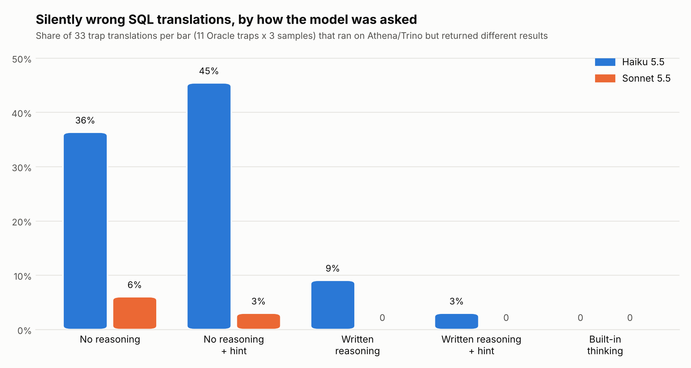

# Knowing Isn't Applying: Silent Errors When LLMs Translate Legacy SQL

*Julio Galarza · November 2026 · all data and schemas synthetic*

## Summary

Public agencies are moving decades of Oracle reporting SQL to cloud engines, and LLMs are an
obvious accelerator. The dangerous failure is not the query that errors out. It is the one that
runs and returns slightly wrong numbers, which then flow into dashboards and decisions unnoticed.

I built a small testbed with objective ground truth: 11 Oracle "traps" (behaviors where a natural
translation to Trino/Athena runs but changes results) plus 4 control queries, each verified by
executing Oracle and Trino on identical synthetic data. I asked Claude Haiku 5.5 and Sonnet 5.5
to translate each query under five conditions and checked every answer by execution.

**Findings**

1. **Without room to reason, Haiku was silently wrong on 36% of trap translations. With its
   built-in thinking on, 0%** (12/33 vs 0/33, Fisher p < 0.001). Written step-by-step reasoning
   recovered most of the gap (9%).
2. **Telling the model to be careful did not help.** A hint to watch for Oracle/Trino
   differences left Haiku at 45% (no improvement; p = 0.31 for the apparent increase).
3. **The model often knew the rule it broke.** On two traps, Haiku answered the isolated fact
   correctly 3/3 times, then got it wrong in all 3 translations when answering directly.
4. **Confidence carried a partial signal.** Haiku's self-reported confidence averaged 72 on
   silently wrong answers vs. 85 on correct ones; Sonnet's 84 vs. 91. Informative, but still
   high in absolute terms.
5. **Sonnet was far more robust** (6% silent errors without reasoning, p = 0.003 vs. Haiku), but
   showed the same "knows but doesn't apply" pattern on its one hard case.

The configuration many production pipelines choose for cost and latency (small model, thinking
disabled, structured JSON output) is the one that fails silently.

## Method

**Cases.** A synthetic permits schema (permits, inspections, contacts) with a deterministic data
generator that plants the rows each trap needs in order to fire. The 11 traps cover NULL
concatenation, integer division, `DECODE` NULL matching, `(+)` outer-join filters, `TRUNC`
date ranges, fractional date subtraction, implicit string-to-number comparison, `ADD_MONTHS`
at month end, `TO_CHAR` month casing, NULL sort order, and `SUBSTR` position 0. Before any model
runs, a validator confirms that each reference translation matches Oracle exactly and that a
plausible naive translation runs on Trino but returns different results.

**Execution.** Oracle Free 23 and Trino (stand-in for Athena engine v3) in Docker. A translation
is *correct* if its result set matches Oracle's, *silent_wrong* if it runs but differs,
*loud_fail* if it errors.

**Conditions.** Built-in model thinking was explicitly switched off in the four core conditions
so that only the prompt varied:

| Condition | Written reasoning | Dialect hint | Built-in thinking | Answer channel |
|---|---|---|---|---|
| No reasoning | no | no | off | structured output (JSON schema) |
| No reasoning + hint | no | yes | off | structured output |
| Written reasoning | yes | no | off | text, then tool call |
| Written reasoning + hint | yes | yes | off | text, then tool call |
| Built-in thinking | no | no | **on** (model default) | structured output |

Each model answered with SQL, a 0-100 confidence, and a list of risks. Each trap was run 3 times
per condition (33 trap translations per cell). A separate **knowledge probe** asked each trap's
underlying fact as an isolated yes/no question, so translation failures can be split into
"didn't know" and "knew but didn't apply."

## Results

| Silent-wrong rate on traps (n = 33 each) | Haiku 5.5 | Sonnet 5.5 |
|---|---|---|
| No reasoning | 36% (12) | 6% (2) |
| No reasoning + hint | 45% (15) | 3% (1) |
| Written reasoning | 9% (3) | 0% |
| Written reasoning + hint | 3% (1) | 0% |
| Built-in thinking | **0%** | **0%** |

Controls were 100% correct in every condition, so reasoning did not break easy queries. The only
other failures were 3 loud errors (all Sonnet, all `integer_division`), which a human would catch
immediately because the query errors out.

**Reasoning, not the hint, drives the effect.** Pooling Haiku's conditions, silent errors fell
from 27/66 without reasoning to 4/66 with written reasoning (p < 0.001). At the case level,
direct answering failed silently on 4 of 11 traps, built-in thinking on none.

**Knows but doesn't apply.** Haiku answered the `ADD_MONTHS` and `TO_CHAR 'MON'` facts correctly
in isolation (3/3 each) yet was silently wrong on every direct translation of both. With the hint,
`||` NULL concatenation joined that list. Sonnet knew the `ADD_MONTHS` month-end rule (3/3) and
still missed it in 2 of 3 direct translations. Thinking also affects recall itself: Haiku's
accuracy on the isolated trap facts rose from 73% answering directly to 100% with built-in
thinking.

**The warning was there, unused.** In 33 of the 34 silent failures, the model's own risk list
mentioned a related concern (measured by keyword match, which is crude); the one exception
reported a confidence of 0. In the no-reasoning conditions, confidence on silent failures was
7-15 points lower than on correct answers (the gap shrank to 2-4 points with reasoning, where
failures were rare). A pipeline that routed low-confidence translations to a human
would catch some of these errors; one that consumed only the SQL would catch none.

**Replication.** An earlier pilot used a different answer mechanism (forced tool call, built-in
thinking left at default). Haiku showed the same pattern: 42% and 55% silent errors without
reasoning, 0% with it. This also addresses a confound in the main design, where the
reasoning conditions answer via a tool call and the direct ones via structured output: in the
pilot both used the same channel and the effect was the same.

## Why this matters for oversight

This is a small, concrete instance of a broader concern: a model can hold the knowledge needed
to do a task correctly, fail to use it, and produce output that looks fine to a busy reviewer.
Two practical implications follow. First, settings chosen for cost and latency (thinking off,
strict structured output) can silently trade away correctness, and a reviewer reading only the
output has no way to tell. Second, the model's own uncertainty signals are partially informative,
which suggests cheap oversight hooks: route on confidence, or surface the model's risk list
next to its output instead of discarding it.

## Limitations

- **Small and synthetic.** 11 traps, 3 samples each, one schema. Per-trap results are anecdotes;
  the aggregate rates are the signal. Samples within a case are not independent, so case-level
  counts are the conservative read.
- **Known gotchas.** Each trap sits alone in a short query. Real migrations bury several in long
  multi-CTE reports, which is likely harder.
- **Crude "warned" measure.** Risk mentions are keyword-matched; an LLM judge or hand labels
  would be more reliable.
- **Probe wording.** Yes/no probes allow 50% guessing. Sonnet answered one *control* probe
  ("does this `GROUP BY` return the same rows in Oracle and Trino?") "no" in all 3 direct
  samples. Its explanations were correct: row order is unspecified without `ORDER BY`, and
  Oracle treats `''` as NULL while Trino does not. The question was ambiguous, not the model;
  it has been reworded for future runs. Control probes do not enter the knows-vs-applies
  analysis.
- **Engine stand-in.** Trino in Docker approximates Athena engine v3.
- **One prompt per condition.** Wording effects were not swept.

## Next steps

- Combine several traps inside realistic long report queries to test whether silent errors grow
  with complexity while confidence stays flat.
- Run the already-built **review-under-pressure** experiment: does a model judging a buggy
  translation approve it more often when told a senior engineer already signed off?
- Human baseline: how often do experienced data engineers catch the same planted bugs, with and
  without the model's confidence and risk list shown?
- Interpretability: when the model answers directly and gets a known fact wrong, is the relevant
  knowledge represented internally but unused?

## Reproduce

See [README.md](README.md). In short: `docker compose up -d`, `python harness/setup_db.py`,
`python harness/validate_cases.py`, then the run commands per model and `--mode`, and
`python harness/score.py`. Raw model outputs are in `results/`.
